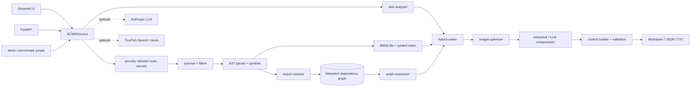

# ACWM: Automatic Context Window Manager

ACWM selects the repository files and symbols an AI coding agent needs for a task under a
fixed token budget, and explains every choice. It indexes a local repository and parses
Python with `ast`. It retrieves candidates with BM25, follows import dependencies through a
NetworkX graph, and packs the best combination of full files and partial excerpts into a
validated, exportable context package.

It runs fully offline. LLM, TinyFish and semantic-search integrations are optional and
clearly labelled when they are mocked or unavailable.

**Live demo** (Render free tier, so the first load after idle takes about a minute):

* Web app (React): <https://acwm-web.onrender.com>
* API docs: <https://acwm-api.onrender.com/docs>
* Original Streamlit UI (kept as a backup): <https://acwm-ui.onrender.com>

To test it yourself, use the two bundled example repositories and the tasks in
[docs/testing_guide.md](docs/testing_guide.md). LibTrack is a held-out repository that ACWM
was not tuned on.

---

## Contents

1. [Overview](#overview)
2. [Problem statement](#problem-statement)
3. [Goals and non-goals](#goals-and-non-goals)
4. [Features](#features)
5. [Architecture](#architecture)
6. [Technology stack](#technology-stack)
7. [Repository structure](#repository-structure)
8. [Prerequisites and installation](#prerequisites-and-installation)
9. [Environment configuration](#environment-configuration)
10. [Running the UI, API and demo](#running-the-ui-api-and-demo)
11. [Demonstrating to judges](#demonstrating-to-judges)
12. [Example task and context package](#example-task-and-context-package)
13. [How it works](#how-it-works)
14. [Benchmarks](#benchmarks)
15. [TinyFish configuration](#tinyfish-configuration)
16. [API endpoints](#api-endpoints)
17. [Tests](#tests)
18. [Known limitations](#known-limitations)
19. [Security notes](#security-notes)
20. [Future improvements](#future-improvements)
21. [Publishing to GitHub](#publishing-to-github)

---

## Overview

Given a task such as *"Add JWT authentication to the FastAPI application and create tests
for protected routes"*, ACWM runs these steps:

1. Indexes the repository safely, skipping secrets, binaries, virtual environments and
   ignored files.
2. Extracts functions, classes, methods, imports, signatures, docstrings and line ranges.
3. Ranks files with BM25, filename and symbol matches, and dependency-graph propagation,
   plus test and config relevance.
4. Selects content under a token budget. Large files become verbatim excerpts with line
   numbers.
5. Exports a Markdown, JSON or TXT package that states what was selected, why, what was
   left out, and the token cost.
6. Compares the result against a lexical-only baseline at the same budget.

## Problem statement

Coding agents waste context on irrelevant files, repeated history and tool output. Simple
filename or keyword search misses the code a change actually touches. For example, the
route a user mentions depends on an auth dependency, which depends on a service, which
reads configuration. Meanwhile, keyword search pulls in files that merely share
vocabulary, such as a *token*-usage billing module during a *JWT token* task. ACWM tries to
keep the dependency chain and drop the distractors within a fixed budget.

## Goals and non-goals

**Goals**

* Deterministic, explainable context selection for Python repositories.
* Hard budget guarantees. Every package is validated after rendering.
* Honest reporting: measured metrics, explicit N/A values, and clear labels on mocked or
  unavailable providers.
* One shared service layer behind the UI, the API and the scripts.

**Non-goals**

* Full program understanding. ACWM sees static imports, not runtime behaviour.
* Generating code or guaranteeing that a change made from the package is correct.
* Being a hosted, multi-tenant service.
* Parsing languages other than Python into symbols. Markdown, JSON, YAML, TOML and INI
  files are indexed as text only.

## Features

**Ingestion**

* Allowed-root enforcement and hierarchical `.gitignore` support.
* Exclusion of VCS, virtual-environment, cache and build directories.
* Detection of sensitive filenames and secret-like content.
* Binary detection, size limits and a symlink-escape guard.
* A detailed indexing report with a reason for every exclusion.

**Parsing**

* Functions, async functions, classes, methods, nested definitions, signatures,
  docstrings, decorators and line ranges.
* Stable symbol IDs (`path::Qualified.name`).
* Syntax errors are tolerated and reported.

**Imports**

* Absolute, relative, conditional and `TYPE_CHECKING` imports, each with a confidence
  label.
* External and ambiguous imports are classified, never invented.

**Retrieval and graph**

* BM25 file and symbol indexes, with matching terms and symbols reported per hit.
* A hybrid ranker with normalised, configurable weights and per-signal breakdowns.
* A NetworkX graph with `imports`, `contains`, `tests`, `references` and `configured`
  edges. Expansion is relationship-aware and cycle-safe, and the UI renders it with
  Graphviz.

**Token budgeting**

* tiktoken with an explicit encoding, plus a labelled heuristic fallback.
* Reserves for the system prompt, task, response and a safety margin.
* Utilization, remaining tokens, and reduction relative to the repository and the baseline.

**Optimizer and compression**

* A core set placed by relevance, with fair-share excerpting when the budget is tight.
* A density-greedy tail with dependency bonus and redundancy penalties.
* Required-file handling and final validation.
* Mode A, extractive: verbatim lines, signature outlines, line markers.
* Mode B, optional LLM summaries: labelled, budget-checked, with a fallback.

**Outputs**

* Markdown, JSON (schema-validated) and TXT export, previewable in the UI.
* Baseline, dependency-expansion and ACWM comparison with Precision@K, Recall@K, MRR,
  coverage, utilization, budget violations and latency.

**Interfaces and integrations**

* A Streamlit UI with eight tabs: Dashboard, Repository Explorer, Context Builder,
  Results, Comparison, Export, Benchmarks and Settings.
* A FastAPI backend with OpenAPI docs, structured errors, a size limit and timeouts.
* An optional TinyFish Search API adapter with an offline mock, and an optional Anthropic
  LLM provider.

## Architecture



See [docs/architecture.md](docs/architecture.md) for the full data flow, the scoring
formula and the optimizer details.

## Technology stack

| Purpose | Choice |
|---|---|
| Language | Python 3.11+ (developed on 3.12) |
| UI and API | Streamlit, FastAPI with Uvicorn |
| Schemas | Pydantic v2 |
| Parsing | Python `ast` |
| Graph | NetworkX |
| Lexical retrieval | `rank-bm25`, with a positive-IDF variant |
| Token estimation | tiktoken (`cl100k_base` by default) |
| Ignore rules | `pathspec` (`.gitignore` semantics) |
| HTTP | httpx (TinyFish) |
| Configuration | python-dotenv |
| Quality | pytest, Ruff, GitHub Actions |
| Optional | `anthropic` (LLM), `sentence-transformers` (semantic) |

## Repository structure

```
app/
  streamlit_app.py           Streamlit UI
  api/                       FastAPI app (main.py), routes.py, schemas.py
  services/                  acwm_service.py (shared business logic), options.py
  core/                      config.py, exceptions.py, logging_config.py, models.py
  ingestion/                 repository_scanner.py, file_filter.py, language_detector.py
  parsing/                   python_parser.py, symbol_extractor.py, import_resolver.py
  analysis/                  task_analyzer.py, text_processing.py
  retrieval/                 lexical_search.py, hybrid_ranker.py, semantic_search.py
  graph/                     dependency_graph.py, graph_expansion.py
  context/                   token_counter.py, budget_optimizer.py, summarizer.py,
                             context_builder.py, context_exporter.py, package_models.py
  evaluation/                baseline.py, metrics.py, benchmark.py
  integrations/              llm_provider.py, tinyfish_client.py, mock_web_research.py
  storage/                   index_store.py, session_store.py
  utils/                     security.py, file_hashing.py
benchmarks/sample_fastapi_tasks.json   labelled benchmark tasks
examples/sample_fastapi_repo/          demo FastAPI service (package `shopapi`)
scripts/run_demo.py, scripts/evaluate_benchmarks.py
tests/unit, tests/integration, tests/fixtures
docs/architecture.md, api.md, evaluation.md, tinyfish_integration.md
```

## Prerequisites and installation

You need Python 3.11 or newer and `pip`. The first run downloads the tiktoken encoding
file (about 1 MB) and caches it locally. If that download fails, ACWM falls back to a
labelled character heuristic.

**Windows (PowerShell)**

```powershell
py -3.12 -m venv .venv          # or: python -m venv .venv
.venv\Scripts\Activate.ps1
python -m pip install -r requirements.txt
```

**macOS / Linux**

```bash
python3 -m venv .venv
source .venv/bin/activate
python -m pip install -r requirements.txt
```

**Optional integrations**

```bash
pip install -r requirements-optional.txt
```

This installs the Anthropic SDK. To enable semantic search, uncomment
`sentence-transformers` in that file first.

## Environment configuration

Copy `.env.example` to `.env`. Every variable is optional.

| Variable | Default | Meaning |
|---|---|---|
| `ACWM_ALLOWED_ROOTS` | (empty) | Extra directories that may be indexed. Use `;`-separated paths on Windows and `:`-separated on macOS/Linux. The project directory is always allowed. |
| `ACWM_TOKEN_BUDGET` | 8000 | Default total budget |
| `ACWM_RESERVED_RESPONSE_TOKENS` | 1500 | Reserved for the model's answer |
| `ACWM_TOKENIZER_ENCODING` | `cl100k_base` | Also `o200k_base` or `p50k_base` |
| `ACWM_MAX_FILE_BYTES` / `ACWM_MAX_FILES` | 1,000,000 / 5,000 | Indexing limits |
| `ACWM_LLM_PROVIDER` | `none` | Set `anthropic` to enable LLM analysis and summaries |
| `ACWM_LLM_MODEL` | `claude-opus-5-5` | Model for the Anthropic provider |
| `ANTHROPIC_API_KEY` | (empty) | Read by the Anthropic SDK; never logged |
| `ACWM_TINYFISH_ENABLED` | `false` | Default for the research toggle |
| `TINYFISH_API_KEY` | (empty) | Real TinyFish Search API; when empty, the mock is used |
| `ACWM_TINYFISH_INCLUDE_DOMAINS` | FastAPI, Pydantic and Python docs | Domains to search |

## Running the UI, API and demo

The main web app is a React + TypeScript + Tailwind single-page app in `frontend/` that
calls the FastAPI backend. It needs Node.js 20 or newer.

```bash
# 1. FastAPI backend  ->  http://127.0.0.1:8000/docs
uvicorn app.api.main:app --reload --port 8000

# 2. React web app (second terminal)  ->  http://localhost:5173
cd frontend
npm ci
npm run dev            # uses http://127.0.0.1:8000 by default (set VITE_API_URL to change it)

# Frontend checks
npm run typecheck && npm test                      # TypeScript + Vitest unit/component tests
npx playwright install chromium                    # once
VITE_API_URL=http://127.0.0.1:8000 npx vite build && npx vite preview --port 4173
npx playwright test                                # end-to-end, in a third terminal

# Streamlit UI (original interface, still supported)  ->  http://localhost:8501
streamlit run app/streamlit_app.py

# One-command demo (index -> analyse -> retrieve -> graph -> optimise -> package
#                   -> compare -> export Markdown/JSON/TXT -> metrics and warnings)
python scripts/run_demo.py                 # options: --budget 4000 --task "..." --out demo_output
```

With `make` installed, the equivalents are `make ui`, `make api`, `make demo`, `make bench`
and `make test`.

## Demonstrating to judges

The demo runs offline in about 5 minutes and needs no keys.

1. Run `python scripts/run_demo.py`. Point out:
   * the indexing report;
   * the files selected for the JWT task, with dependency chains such as
     `routes/auth.py -> services/auth_service.py`;
   * partial excerpts;
   * the comparison table. At 4000 tokens, ACWM covers 8 of 11 labelled files versus 3 of
     11 for BM25 alone.
2. Run `streamlit run app/streamlit_app.py`.
   1. **Repository Explorer:** click *Index / re-index* (the sample path is prefilled). Show
      the Symbols tab, the Dependencies graph for `shopapi/api/dependencies.py`, and the
      Excluded tab.
   2. **Context Builder:** use the default JWT task and budget 4000, then click *Build
      Context*.
   3. **Results:** show per-signal scores, selection reasons, the dependency graph with the
      selection highlighted, known omissions, and source previews (note the `PARTIAL`
      excerpts with line ranges).
   4. **Comparison:** pick the benchmark task `jwt-auth` (labels prefill) and click *Run
      comparison*.
   5. **Export:** preview and download Markdown or JSON.
   6. **Benchmarks:** click *Run benchmarks*. All numbers are measured live.
3. Optionally, open `http://127.0.0.1:8000/docs` and try `POST /context/compare`.
4. Be candid about limitations: the static-import view, a small benchmark built by the
   same author, and tiktoken estimates.

## Example task and context package

**Task:** `Add JWT authentication to the FastAPI application and create tests for
protected routes.` The output below was produced by `python scripts/run_demo.py` with a
total budget of 4000 tokens (1,869 usable after reserves). It is the measured output,
abbreviated:

```
[5] ACWM selected 9 items, 1850 tokens (utilization 99%, 81% smaller than the whole repository):
    - shopapi/api/dependencies.py            full           225 tok  score 0.667
    - shopapi/api/routes/auth.py             full           209 tok  score 0.621
    - shopapi/main.py                        full           145 tok  score 0.542
    - shopapi/api/routes/users.py            full           128 tok  score 0.491
    - shopapi/api/routes/orders.py           full           216 tok  score 0.454
    - shopapi/services/auth_service.py       full           406 tok  score 0.416
        via shopapi/api/routes/auth.py -> shopapi/services/auth_service.py
    - tests/conftest.py                      excerpt PARTIAL   190 tok  score 0.618
    - tests/test_auth.py                     full           196 tok  score 0.577
    - tests/test_orders.py                   excerpt PARTIAL   131 tok  score 0.418

[6] Comparison at the same usable budget (1869 tokens)
    method      files  tokens   P@5   R@5   MRR  cover  missing relevant
    baseline        9    1848  0.60  0.27  0.33   0.27  orders.py, users.py, config.py, security.py, schemas.py, auth_service.py, test_auth.py, test_orders.py
    dependency      9    1852  0.80  0.36  1.00   0.55  config.py, security.py, schemas.py, test_auth.py, test_orders.py
    acwm            9    1850  0.80  0.36  1.00   0.73  config.py, security.py, schemas.py
```

The Markdown package (`demo_output/context_package.md`) contains these sections:

* task;
* repository summary;
* retrieval configuration;
* token statistics: budget, reserves, usable, rendered, utilization and reductions;
* a table of selected files with reasons;
* dependencies among the selected files;
* relevant tests and configuration;
* the code context;
* excluded candidates with reasons;
* known omissions, for example `shopapi/main.py imports shopapi/core/config.py, which was
  not included`;
* warnings and limitations.

A partial excerpt from that package, copied verbatim:

````
### tests/conftest.py [excerpt PARTIAL; lines 3-12, 33-36 of 36]
```python
# [ACWM partial excerpt: verbatim source lines; omitted regions are marked]
# module docstring: Shared pytest fixtures.
# ... lines 1-2 omitted ...
# --- lines 3-12 ---
from __future__ import annotations

import pytest
from fastapi.testclient import TestClient

from shopapi.core.config import Settings
from shopapi.db.database import reset_database
from shopapi.db.repositories import ProductRepository
from shopapi.main import create_app
from shopapi.services.auth_service import AuthService
# ... lines 13-32 omitted ...
# --- lines 33-36: auth_headers ---
@pytest.fixture()
def auth_headers(client, demo_user):
    response = client.post("/auth/login", json=demo_user)
    return {"Authorization": f"Bearer {response.json()['access_token']}"}
```
````

## How it works

### Retrieval and ranking

* BM25 (`rank-bm25`, with a positive Lucene-style IDF so that small repositories are not
  zeroed out) runs over two indexes:
  * **File documents:** path tokens ×3, symbol names ×2, docstrings, imports and full text.
  * **Symbol documents:** name, signature, docstring and body.
* Tokens are split on `snake_case` and `CamelCase` and lightly stemmed.
* The task analyzer adds synonyms (*auth* → token, login, credential) as secondary terms
  at half weight, and canonical short forms (*authentication* → `auth`) as primary terms.
* Every signal is normalised to [0, 1] and combined as `Σ wᵢ·sᵢ / Σ wᵢ`. The defaults are
  lexical 0.35, filename 0.10, symbol 0.15, dependency 0.20, test 0.10, config 0.05 and
  semantic 0.
* Documentation files get a ×0.5 prior unless the task mentions docs.
* The UI and API show every component score and a list of reasons for each file.

### Dependency graph

* File nodes are linked by `imports` (resolved statically, with high, medium or low
  confidence), `tests` (via imports or the `test_x.py` ↔ `x.py` convention), `references`
  (a string literal names a file) and `configured` edges. Symbol nodes hang off their
  files through `contains` edges.
* Expansion starts from the strongest direct matches and propagates relevance with
  `score × relation weight × confidence × 0.75` per hop. It stops at the configured depth
  (default 2) and is cycle-safe.
* Each reached file records its path, for example `routes/orders.py ->
  api/dependencies.py -> services/auth_service.py`.

### Token-budget algorithm

1. Compute the usable budget:
   `usable = total − system(400) − task − response(1500) − 5% safety margin`.
2. Place required files first: full, then excerpt, then outline. A required file that
   cannot fit is reported, never dropped silently.
3. Place the core set (scores ≥ 50% of the top score) by relevance. If it does not fit,
   give each file a fair share and excerpt it.
4. Fill the tail greedily by `utility / tokens^0.5`, with a dependency bonus, a redundancy
   penalty and near-duplicate exclusion.
5. Re-render and count. Trim the lowest-value items if formatting pushed the package over
   budget, or fail if required items alone exceed it.

The per-file cap is 40% of the usable budget, which keeps one large file from consuming
everything. See [docs/architecture.md](docs/architecture.md#budget-optimizer) for
complexity and limitations.

### Compression strategy

* **Extractive (default, no API).** Imports, then the full source of the matched symbols
  (with their enclosing class header), then a bounded signature outline of the remaining
  symbols. Original line numbers and `omitted` markers are kept. The ladder shrinks from 5
  symbols to 2, to 1, to 1 without an outline, and finally to an outline only. Non-Python
  files use line windows around matching terms. Source is never rewritten.
* **LLM (`compression="llm"`, optional).** Task-focused summaries are generated only for
  high-ranked files that did not fit. They are labelled `[ACWM LLM-GENERATED SUMMARY ...]`,
  token-checked, and never replace selected source. Without a provider, ACWM falls back to
  extractive outlines and emits a warning.

## Benchmarks

```bash
python scripts/evaluate_benchmarks.py --budgets 3000 4000 6000 8000
```

The table shows coverage of relevant files, measured on 2026-10-18 over 5 labelled tasks
on the sample repository. Full metrics and caveats are in
[docs/evaluation.md](docs/evaluation.md).

| Total budget | baseline (BM25) | + dependency expansion | full ACWM | ACWM tokens vs dependency |
|---|---|---|---|---|
| 3000 | 0.250 | 0.421 | **0.506** | 907 vs 909 |
| 4000 | 0.438 | 0.726 | **0.779** | 1739 vs 1853 |
| 6000 | 0.797 | **0.967** | 0.933 | 3386 vs 3750 |
| 8000 | 0.915 | **0.967** | 0.933 | 3684 vs 5642 |

* ACWM beats the lexical baseline on every metric at every budget.
* Against plain dependency expansion, ACWM is better at tight budgets. At generous budgets
  it covers slightly fewer files while using up to 35% fewer tokens.
* The benchmark is small and the heuristics were tuned on it, so treat these numbers as a
  demonstration, not a general claim.

## TinyFish configuration

The adapter targets the documented **TinyFish Search API** (`GET
https://api.search.tinyfish.ai`, `X-API-Key` header) to find official documentation for a
task.

* Set `TINYFISH_API_KEY` (and optionally `ACWM_TINYFISH_ENABLED=true`) to enable it.
* Without a key, a clearly labelled offline mock is used.
* **The live service has not been called from this project** (no key was available). The
  adapter is tested with mocked HTTP responses only.

Details and the documentation check date are in
[docs/tinyfish_integration.md](docs/tinyfish_integration.md).

## API endpoints

| Method | Path | Purpose |
|---|---|---|
| GET | `/health` | Status, version, provider status |
| POST | `/repositories/index` | Index a directory under an allowed root |
| GET | `/repositories/{repository_id}` | Summary and report, plus optional graph and symbols |
| POST | `/context/build` | Build a context package |
| POST | `/context/compare` | Baseline vs dependency vs ACWM, with optional labels |
| POST | `/context/export` | Markdown, JSON or TXT from a package or a build request |
| GET | `/benchmarks` | List labelled benchmark tasks |
| POST | `/benchmarks/run` | Run the benchmark and return measured metrics |

Request and response formats are in [docs/api.md](docs/api.md), and the interactive docs
are at `/docs`.

## Tests

```bash
pytest                       # unit + integration (API via TestClient, UI via Streamlit AppTest)
ruff check . && ruff format --check .
cd examples/sample_fastapi_repo && python -m pytest   # the sample app's own tests
```

The suite covers:

* scanning, exclusions, secrets, gitignore, size limits, binaries, symlinks, empty and
  malformed repositories;
* AST parsing and import resolution;
* graph construction and expansion;
* BM25, hybrid ranking and token counting;
* the optimizer, including overflow, required files and redundancy;
* extractive compression and package assembly;
* Markdown, JSON (schema) and TXT export;
* metrics, baseline comparison and benchmarks;
* TinyFish (mocked HTTP), the LLM provider (mocked) and fallbacks;
* every API endpoint, with valid and invalid requests;
* the main Streamlit workflow.

## Known limitations

* **Static analysis only.** Dynamic imports, dependency-injection wiring, string-based
  plugin loading, monkeypatching and runtime call graphs are invisible. Expansion
  under-approximates coupling.
* **Symbol extraction is Python-only.** Other supported formats are indexed as text.
  Tree-sitter is not included.
* **Token counts are estimates.** tiktoken is not the target model's tokenizer; a 5% safety
  margin is reserved.
* **Heuristic optimizer.** It is greedy, not an optimal knapsack. Its thresholds and
  weights were tuned on a small sample repository.
* **Lexical retrieval.** BM25 misses paraphrases unless the optional semantic signal is
  installed. That signal is not covered by the default test suite.
* **Partial excerpts.** An excerpt can omit lines the agent needs. Omitted ranges are
  marked, and the full file stays available in the index.
* **In-memory indexes.** They are rebuilt after a restart; there is no incremental
  re-indexing.
* **Unverified live integrations.** The Anthropic and TinyFish adapters have only been
  tested against mocks.
* **No downstream guarantee.** A good context package does not guarantee a correct code
  change.

## Security notes

* Repository files are untrusted input. They are read and parsed, **never imported or
  executed**.
* Only directories under `ACWM_ALLOWED_ROOTS` (plus the project directory) can be indexed.
* Path traversal in `required_paths` is rejected.
* Symlinked directories are not followed, and symlinked files pointing outside the root
  are excluded.
* `.env`, key and certificate files, credential files and contents that match secret
  patterns are excluded. Reports and logs show only a label, never the value. A logging
  filter redacts API keys and `X-API-Key` headers.
* Credentials are read only from environment variables, and `.env.example` contains no
  real values.
* The API enforces a 1 MB request limit, processing timeouts and structured errors without
  stack traces. There is no shell execution.
* External content (TinyFish and LLM output) is labelled as untrusted, length-limited, and
  never executed. Prompts instruct the model to ignore instructions embedded in files.
* **This is a local developer tool, not a hardened multi-tenant service.** Do not expose
  the API publicly.

## Future improvements

* Tree-sitter parsers for TypeScript, Go and Java, with tests.
* Call-graph approximation (name resolution of calls) to complement imports.
* Persistent, incremental index (file-hash based) on disk.
* A larger, independently labelled benchmark across several real open-source
  repositories, with a held-out split.
* Verified live TinyFish Fetch-API integration for pulling documentation sections.
* Exact token counts via the target model provider's token-counting endpoint.

## Publishing to GitHub

No GitHub repository has been created for this project yet. To publish it:

```bash
git init
git add .
git commit -m "Initial commit: ACWM"
git branch -M main
git remote add origin https://github.com/<your-account>/acwm.git
git push -u origin main
```

Check `git status` before committing so that no `.env` file is included (it is already in
`.gitignore`). GitHub Actions (`.github/workflows/tests.yml`) then runs lint, tests, the
sample application's tests and the demo on Python 3.11 and 3.12.

## Deploying to Render

`render.yaml` is a Render Blueprint that creates three free services from this repository:

| Service | Start command | Health check |
|---|---|---|
| `acwm-web` | static site: `cd frontend && npm ci && npm run build`, publishes `frontend/dist` | — |
| `acwm-ui` | `streamlit run app/streamlit_app.py --server.port $PORT --server.address 0.0.0.0 ...` | `/_stcore/health` |
| `acwm-api` | `uvicorn app.api.main:app --host 0.0.0.0 --port $PORT` | `/health` |

To deploy:

1. Sign in at <https://dashboard.render.com> with GitHub.
2. Choose **New → Blueprint** and select this repository. Render reads `render.yaml`.
3. Click **Apply**. The first build takes a few minutes.

On the deployed site:

* The UI can index the bundled sample repository. Only the deployed project directory is
  an allowed root, so visitors cannot browse the server's file system.
* Each browser session gets its own index and settings.
* No API keys are needed. TinyFish research uses the labelled offline mock unless you set
  `TINYFISH_API_KEY` in the Render dashboard.
* Free Render instances sleep after inactivity, so the first request after a pause can take
  about a minute.

## License

MIT. See [LICENSE](LICENSE).
