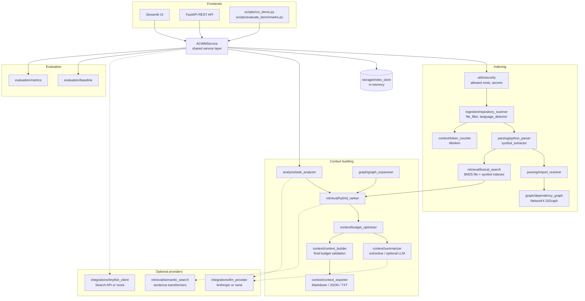

# ACWM architecture

ACWM is a layered Python application. A single service layer
(`app/services/acwm_service.py`) holds the business logic. The Streamlit UI
(`app/streamlit_app.py`) and the FastAPI backend (`app/api/`) are thin adapters over it,
so both front ends always behave identically.



## Data flow

### 1. Indexing (`ACWMService.index_repository`)

1. **Path validation** (`utils/security.validate_repository_path`): the requested path is
   resolved and must lie inside an allowed root (`ACWM_ALLOWED_ROOTS` plus the project
   directory). Null bytes and empty paths are rejected.
2. **Scanning** (`ingestion/repository_scanner.scan_repository`) walks the tree with
   `os.walk(followlinks=False)`. It applies the rules in this order:
   * skips VCS, virtual-environment, cache and build directories;
   * skips symlinked directories and does not follow them;
   * skips symlinked files whose target is outside the root;
   * excludes sensitive filenames (`.env`, `*.pem`, `id_rsa`, ...) *without reading them*;
   * applies hierarchical `.gitignore` rules (via `pathspec`), custom exclusion globs, and
     generated/lock-file patterns;
   * drops unsupported types, oversized files, and binary content (null bytes or invalid
     UTF-8);
   * excludes files whose contents match secret patterns. Only a label is recorded, never
     the matched value;
   * stops at the configured file-count and total-byte limits.

   Every exclusion gets a reason in the `IndexingReport`.
3. **Parsing** (`parsing/python_parser.parse_python`) uses `ast.parse` only; repository
   code is never imported or executed. It extracts modules, functions, async functions,
   classes, methods and nested definitions, with signatures, docstrings, decorators and
   line ranges. Symbol IDs are `<relative path>::<qualified name>`. Imports are tagged as
   conditional (inside `try`/`if`) or `TYPE_CHECKING`-only. Syntax errors produce a
   `parse_error` instead of an exception.
4. **Import resolution** (`parsing/import_resolver`) maps imports to repository files.
   The rules are listed in order:

   | Rule | Confidence |
   |---|---|
   | Exact dotted-module match | high |
   | `from pkg import name`, when `pkg.name` is a submodule | high |
   | Relative imports, resolved against the importing package | high |
   | Unique suffix match (repository indexed from a parent directory) | medium |
   | Ambiguous suffix match | unresolved; no edge is created |

   Stdlib names are never bound to local files by suffix. Other imports are classified
   as external.
5. **Dependency graph** (`graph/dependency_graph`): see [Dependency graph](#dependency-graph).
6. **BM25 indexes** (`retrieval/lexical_search`) are built over file documents and
   symbol documents.

### 2. Context building (`ACWMService.build_context`)

1. **Task analysis** (`analysis/task_analyzer`) is deterministic. It produces:
   * keywords, technical terms and identifiers (`snake_case`, `CamelCase`, back-ticked
     names, file names);
   * test and config intent;
   * synonym expansion (e.g. *auth* → token, login, credential);
   * canonical short forms (*authentication* → `auth`, *database* → `db`).

   An optional LLM can add search terms; on any failure the deterministic result is used.
2. **Budget planning** (`context/token_counter.plan_budget`):

   `usable = total - system reserve - task tokens - response reserve - safety margin`

   A non-positive result is rejected with `BudgetExceededError` (`reason:
   "reservations"`). Its `details` come from
   `token_counter.budget_exceeded_details`: the reserves, needed and available tokens,
   the shortfall, and `suggested_budget`, the smallest total (rounded up to 500) whose
   usable space covers the need, accounting for the safety margin growing with the
   total.
3. **Retrieval and ranking** (`retrieval/hybrid_ranker`): BM25 hits, filename and symbol
   matches, graph expansion, test, config and optional semantic signals are each
   normalised to [0, 1], then combined with configurable weights.
4. **Selection.** The full ACWM mode uses `context/budget_optimizer`. The two comparison
   modes use `evaluation/baseline.rank_order_select`.
5. **Compression** (`context/summarizer`) has two modes:
   * *Extractive excerpts* keep verbatim source lines with line markers.
   * *Optional LLM summaries* are labelled `[ACWM LLM-GENERATED SUMMARY ...]`. They are used
     only for files that did not fit, and fall back to signature outlines.
6. **Assembly and validation** (`context/context_builder.assemble_package`): the
   agent-facing code block is rendered and its tokens counted. If it exceeds the usable
   budget, the lowest-value non-required items are removed and recorded as omissions. If
   required items alone exceed the budget, a `BudgetExceededError` is raised
   (`reason: "required_files"`, same structured details). The builder
   also records dependencies among the selected files and known omissions (imports of
   selected files that were left out).
7. **Export** (`context/context_exporter`) writes Markdown, JSON or plain text. JSON is
   round-trip validated against the `ContextPackage` Pydantic schema.

## Ranking formula

```
combined = Σ_i w_i · s_i / Σ_i w_i          (enabled signals only)
```

| Signal | Definition (each in [0, 1]) | Default weight |
|---|---|---|
| lexical | BM25 score / max BM25 score for the query | 0.35 |
| filename | share of primary query terms in the path; 1.0 on exact file-name match | 0.10 |
| symbol | best symbol BM25 / global max; 1.0 on exact symbol-name match | 0.15 |
| dependency | propagated relevance from graph expansion | 0.20 |
| test | test files: 1.0 if linked to a seed or strong dependency and tests are requested, 0.4 if only requested, 0.3 if linked only | 0.10 |
| config | config files: 1.0 if config terms are in the task or the file is reached by expansion; 0.4 on lexical match only | 0.05 |
| semantic | optional cosine similarity mapped to [0, 1]; weight ignored when unavailable | 0.00 |

Documented adjustment: documentation files are multiplied by 0.5 unless the task
mentions docs. Token cost and redundancy are handled by the optimizer, not by this
score.

## Dependency graph

Nodes:

* `file:<path>` for every indexed file;
* `sym:<id>` for every Python symbol.

| Relation | Direction | Confidence |
|---|---|---|
| `imports` | file → file | high, or medium for conditional, `TYPE_CHECKING` or suffix matches |
| `contains` | file → symbol, class → method | high |
| `tests` | test → source | high via import; medium via naming convention (`test_x.py` ↔ `x.py`) |
| `references` | file → file, a string literal names another file | medium |
| `configured` | explicit dependencies (API parameter in `build_dependency_graph`) | high |

Expansion (`graph/graph_expansion.expand`) is a depth-bounded BFS starting from up to six
non-documentation seed files (the strongest direct matches):

```
score(next) = score(cur) × relation_weight × confidence_factor × 0.75
```

* Relation weights: `imports` forward 1.0, reverse 0.45; `tests` reverse 0.8 (0.4 when the
  task does not ask for tests), forward 0.6; `references` forward 0.7.
* Confidence factors: high 1.0, medium 0.7, low 0.4.
* Each visited path tracks its own chain and nodes are only revisited on a strictly better
  score, so cycles terminate.

Static imports cannot reveal dynamic imports, string-based plugin loading, dependency
injection wiring or runtime call graphs. Expansion therefore under-approximates real
coupling, and every hit carries its path and confidence for review.

## Budget optimizer

See the module docstring in `app/context/budget_optimizer.py`. In summary:

1. **Eligibility.** A candidate must score at least `max(0.04, 0.3 × top)`.
2. **Required files.** These are placed first. Each is tried as a full file, then an
   excerpt, then an outline. A required file that cannot fit is reported loudly in the
   omissions.
3. **Core set.** Up to 12 candidates scoring at least 50% of the top score are placed in
   score order. If they do not all fit in full, each receives a fair share
   (`1.5 × remaining / core files left`) and is excerpted as needed, so that coverage beats
   completeness.
4. **Tail.** Remaining candidates are added greedily by
   `utility / tokens^0.5`, where utility includes:
   * a variant factor: full 1.0, excerpt 0.85, outline 0.5;
   * a ×1.25 dependency bonus when the file is graph-adjacent to a selected file;
   * a `(1 − overlap)` redundancy penalty when line-set Jaccard overlap is ≥ 0.5.

   Near-duplicates (overlap ≥ 0.9) are excluded outright.
5. **Final validation.** The context builder re-renders the selection and validates it
   against the usable budget.

**Complexity.** O(n²) priority evaluations over n eligible candidates, each O(s) for the
redundancy check over the s selected items. Excerpt ladders are cached per file.

**Limitations.**

* The algorithm is greedy, not an optimal knapsack.
* Thresholds and weights are heuristics tuned on a small sample.
* Relevance of a partial excerpt is approximated by a constant factor.

## Storage

* `storage/index_store.IndexStore` is a thread-safe in-memory LRU of indexed
  repositories. Indexes are rebuilt on restart; the sample repository indexes in about
  0.2 s.
* `storage/session_store.SessionStore` records metadata of recent runs only, never file
  contents.

## Security boundaries

ACWM is a **local developer tool**, not an isolated multi-tenant service. Its
protections are defence in depth:

* allowed roots;
* no code execution;
* no symlink escape;
* secret exclusion and log redaction;
* request-size limits;
* processing timeouts (the worker thread is not killed on timeout).

They do not make it safe to expose ACWM to untrusted users on a network.

## Conversation manager

`app/conversation/manager.ConversationManager` keeps a growing chat inside
`context.total_tokens` (from `config.yaml`).

1. **Every turn:** `add()` records each message with its tokens and metadata (role, turn,
   timestamp, pinned, required, score). No LLM call.
2. **Trigger:** `prepare()` compacts when usage reaches `compact_threshold` and the
   cooldown has passed (or, during a cooldown, runs a heuristic-only compaction if the
   window would overflow).
3. **Compaction:** older messages that are not recent, pinned or required are sent to the
   manager LLM (`manager_llm.ManagerLLM`) with the current request. Its JSON reply is
   validated against `models.ManagerOutput` (`summary`, `pinned_facts`, `message_scores`,
   `superseded`, `required_for_task`); one error-correction retry, then
   `heuristics.heuristic_output`. Facts are merged by `facts.merge_facts`.
4. **Eviction:** if usage is above `compact_target`, `eviction_order()` removes old,
   unpinned, not-required messages, lowest score first, then oldest.
5. **Budget report:** `budget_report()` attaches a `BudgetReport` to every window:
   `over_target` (compaction could not reach the target), `over_budget` (the window exceeds
   the budget) or `ok`, with a per-part `breakdown` (system prompt, pinned facts, summary,
   recent turns, pinned messages, required messages, older messages) and an explanation.
6. **Metrics:** `record_turn()` stores a `TurnMetrics` row with main and manager tokens,
   cost, manager latency, compaction mode and budget status.

The benchmark (`evaluation/conversation_benchmark.py`) runs the same conversation through
`FullContext`, `NaiveTruncation` and the manager, and is exposed at
`POST /conversation/benchmark` and on the web app's Conversation page.
